<p align="center">
  
</p>

<h1 align="center">PAINQ // IS GOD</h1>

<p align="center">
  <samp>SOFTWARE DEVELOPMENT STUDENT · EAT / SLEEP / REPEAT</samp>
</p>

<p align="center">
  <a href="https://github.com/PainQisGod">
    
  </a>
  
  
</p>

---


```text
HANDLE       : PainQ
ROLE         : Software Development student
INTERESTS    : Programming, web development, esports & games
CURRENTLY    : Learning, experimenting, and building projects
PHILOSOPHY   : Jack of all trades, master of none.
```


| PROJECT | TRANSMISSION |
|:--|:--|
| [Jongrai](https://github.com/PainQisGod/jongrai) | MLBB project |
| [Bayonette](https://github.com/PainQisGod/bayonette) | E-commerce-style web project |
| [Paygone World Cup](https://github.com/PainQisGod/paygone-worldcup) | World Cup-themed project |


<p>
  
  
  
  
  
  
  
  
</p>


<p align="center">
  
  
</p>

---

<p align="center">
  
</p>
