<p align="center">
  
</p>

<h1 align="center">PAINQ // NIGHT CITY NETRUNNER</h1>

<p align="center">
  <samp>SOFTWARE DEVELOPMENT STUDENT · CODE / CREATE / REPEAT</samp>
</p>

<p align="center">
  <a href="https://github.com/PainQisGod"></a>
  
  
</p>

---

### `01 // ABOUT ME`

```text
Handle      : PainQ
Class       : Software Development student
Interests   : Programming, web development, games & technology
Currently   : Learning, experimenting, and building projects
Philosophy  : Jack of all trades, master of none.
```

### `02 // SELECTED PROJECTS`

| PROJECT | DESCRIPTION |
|:--|:--|
| [Bayonette](https://github.com/PainQisGod/bayonette) | E-commerce-style web project |
| [Jongrai](https://github.com/PainQisGod/jongrai) | ML:BB Project |
| [Paygone World Cup](https://github.com/PainQisGod/paygone-worldcup) | World Cup-related project |

### `03 // TECH I WORK WITH`

<p align="left">
  
  
  
  
  
</p>

---

<p align="center">
  <samp>「 WAKE THE FUCK UP, SAMURAI. 」</samp><br />
  <sub>Night City never sleeps. Neither does curiosity.</sub>
</p>
